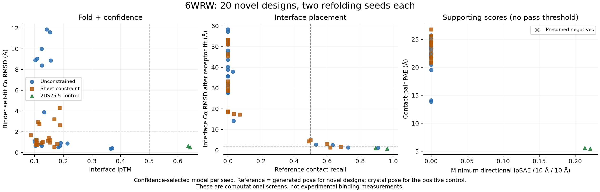
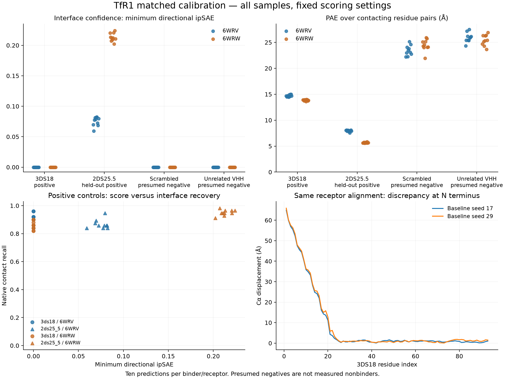
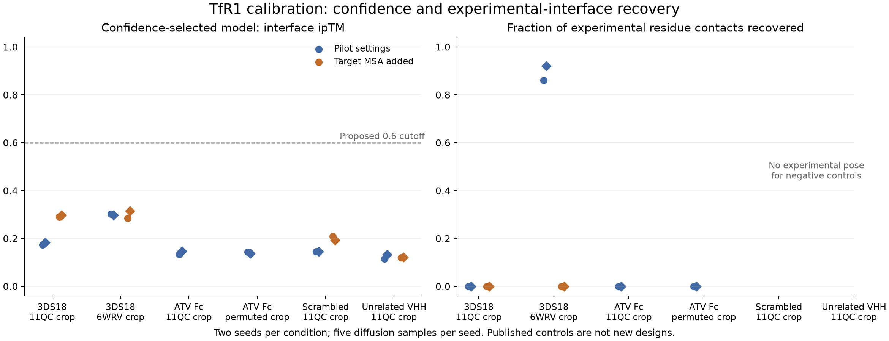

# TfR1 days 1–3: results

The workflow is built and has run on real designs. The initial 75-design pilot found six exploratory pKa-lowering variants, none passing its parent-quality gate. Historical results below retain those original decisions.

## Latest expansion and histidine follow-up — 21 October 2026

**Four new human-target parents pass both fresh-seed structural checks; A41H is retained as a qualified pH-direction hypothesis.** The additional 200-design apical campaign yields 16 initial full passes; four of six prospectively selected diverse candidates pass confirmation, with all selected controls passing. The 20-variant/comparator His panel and fresh-seed follow-up identify A41H as the strongest retained variant: 9/10 raw sample passes, two consistent negative pKa shifts, but one failure of the strict free-pKa 6–7 heuristic. The strict direction-pass count remains zero. No experimental binding or pH switching is established.

The 81-prediction human/mouse comparison is inconclusive: the positive human control fails on the AlphaFold-human target, preventing a species-only interpretation of low mouse scores. Mouse cross-reactivity remains unknown. Uniform preparation diagnostics preserve every raw failure and do not rescue candidates retroactively.

See the [round report](next_round/RESULTS.md), [review bundle](next_round/review_bundle/manifest.json), and [working method](next_round/METHODS.md). This round includes 599 structural predictions. Observed gross Modal usage reached approximately **$9.96 before credits**, subject to meter lag; all cloud apps are stopped and 52 local tests pass. No upstream issue, PR or challenge submission was filed. The next recommendation is pH-direction triage on the new parents before another large generation batch.

## Earlier independent mutant test — 21 October 2026

**D51H/T70H is rejected after independent refolding.** The matched controls pass, but all ten mutant samples have interface ipTM 0.091–0.116 and almost no original interface contacts. The parent preserves its intended pose and higher confidence, but one selected model fails the strict clash rule. No sequence advances under this matched experiment's both-seed rule. The earlier pKa calculation remains conditional on an interface the mutant predictor did not recover.

See the [full mutant report](mutant_validation/RESULTS.md). At that stage, the next recommendation was a diagnostic test of D51H and T70H separately with parent and controls; the expanded follow-up above now includes those tests. At that stage, gross compute usage was approximately **$7.96**, all cloud apps were stopped, and 44 tests passed. No upstream issue, PR or challenge submission was filed.

## Earlier confirmation and direction result — 21 October 2026

The subsequent 200-design screen produced two reproducible apical leads. A held fresh-seed batch exposed a distorted positive-control receptor selected by confidence. A separate, prospectively specified 50-prediction confirmation applied a target-conformation filter before confidence ranking, with identical treatment of leads and controls. All selected controls pass; **one parent, `apical_long_015`, passes the full screen in both fresh seeds**. The shorter lead remains a backup after a selected model narrowly misses the unchanged full-context fit cutoff.

Two His pairs were tested on the passing parent, each on two predicted poses with two local rebuild seeds. **D51H/T70H passes the direction criteria in all four models**; D51H/K62H fails the second pKa-shift criterion. Saved structures and pKa tables pass an eight-model evidence audit. At that stage, the mutant had not been independently refolded; the subsequent experiment above rejects it. Neither binding, mouse cross-reactivity nor pH switching has been experimentally established.

See the [confirmation report](confirmation/RESULTS.md), [direction report](confirmation_direction/RESULTS.md), and [review bundle](confirmation_direction/review_bundle/manifest.json). At that stage, gross Modal usage was approximately **$7.79**, all cloud apps had stopped, and 42 tests passed. No upstream issue, PR or challenge submission was filed. Independent refolding was the next priority and is now complete, as reported above.

## Completed 6WRW generation comparison — 21 October 2026

**Twenty new designs completed; zero advance under the frozen two-seed screen.** The matched control checks passed. This is a completed negative pilot, not evidence that any candidate is an experimental nonbinder.

| Arm | Unique designs | Best interface ipTM, all samples | Fold criterion in both selected models | Interface-pose criterion in both selected models | All criteria in both seeds |
|---|---:|---:|---:|---:|---:|
| Unconstrained | 10 | 0.371 | 6/10 | 1/10 | 0/10 |
| Five-residue sheet constraint | 10 | 0.189 | 7/10 | 1/10 | 0/10 |

No novel sample reached interface ipTM 0.50, even among all 200 samples rather than only the confidence-selected models. All novel minimum-directional ipSAE scores at the fixed 10 Å settings were zero. The small comparison does not show a benefit from this particular five-residue sheet constraint; it does not rule out other ways of designing sheet extension.

**Controls:** 2DS25.5 recovered the experimental interface in all ten samples, with ipTM 0.624–0.643, native-contact recall 89–96%, and binder self-fit Cα RMSD 0.51–0.84 Å. Both selected models passed the predeclared positive-control check. The scrambled and unrelated-VHH controls remained below 0.145 and 0.127 respectively. These are two presumed negatives, not an experimental specificity panel.

**Exploratory structures worth retaining:** `unconstrained_03` has reproducible folding (0.37–0.41 Å self-fit Cα RMSD), all three hotspot contacts, valid receptor fits and no detected <2 Å full-context clashes. However, its interface ipTM is only 0.366–0.371, contact PAE is 13.86–14.10 Å, and interface placement differs from its generated reference by 2.45–2.73 Å. It fails confidence and pose criteria. `unconstrained_02` passes the geometric checks in both selected models but has ipTM 0.183–0.188 and contact PAE 22.27–22.50 Å. Neither is a qualified parent. `sheet_05` preserves interface geometry but has low confidence and one close atom pair in one selected model. Their fully predicted structures are archived as [exploratory models](generation_comparison/exploratory_models/manifest.json), not submission recommendations.

**Execution:** both arms used 88-residue de novo binders, the same bound 6WRW 194-residue receptor, native hotspots 208/210/211, the same exclusion masks and pinned design/inverse-folding stages. The sheet arm alone conditioned binder positions 33–37 as sheet; this does not enforce interchain strand pairing or register. The three hotspots are species-variable, so this is explicitly a human-first experiment. Refolding used the original fixed receptor coordinates, no binder templates, no MSA, fresh seeds 101/211, three recycles, 200 diffusion steps and five samples per sequence. Twenty designs plus three controls produced **230 predictions**, all analyzed. Twenty unique sequences were generated. Feature metadata confirms the requested hotspots in every generated output and the requested secondary-structure labels in the sheet arm. Input SHA256 hashes match the launch reservation.

**Screen interpretation:** the confidence-selected sample was fixed by `0.8*ipTM + 0.2*pTM` before geometric evaluation. Both seeds had to pass interface confidence ≥0.50, binder self-fit Cα RMSD ≤2 Å, receptor-aligned interface Cα RMSD ≤2 Å, design-contact recall ≥0.5, at least two of three hotspots contacted, at least half of contact pairs in the reference region, a valid context fit and zero <2 Å receptor/glycan clashes. Interface RMSD and contacts for novel designs compare against generated backbone geometry, not a crystal binder pose. The inverse-folding writer puts placeholder sidechains in references, so design-contact recall uses binder N/CA/C/O against target heavy atoms in both reference and prediction; fully predicted atoms are used for hotspot, PAE and clash checks. This clarification was recorded before examining new refolding results, with no threshold changes. Reproducibility within one predictor is not independent binding validation.

**Decision:** do not scale either arm or start new histidine engineering from this batch. Preserve `unconstrained_03` and `unconstrained_02` as diagnostic leads. A subsequent proposal should change the interface-design strategy rather than repeat this batch or relax its gates. No new GPU jobs, switch scans or submissions were launched after this result. The previous broader calibration gate remains failed; this experiment does not retroactively validate it. No mouse binding, affinity or pH-switching claim is made.

**Cost and checks:** latest reported gross Modal usage is approximately **US$3.89 total**, billed US$0 after credits. The run took 1,072 seconds; the earlier failed preflight took 18.46 seconds and generated no designs. Both attempts share the authorized US$5 experiment allowance within the US$30 gross project cap. Billing may lag. Both apps are verified stopped with zero tasks. Thirty local tests pass; the comparison's actual feature arrays, sample-coordinate correspondence, exported PAE dimensions and chain order were checked.

Evidence: [all designs and per-seed checks](generation_comparison/designs.csv), [all sequences](generation_comparison/all_designs.fasta), [full 230-sample results](generation_comparison/results.json), [frozen plan](../data/generation_comparison/manifest.json), [metric clarification](generation_comparison/run_record/analysis_clarification.json), [remote preflight](generation_comparison/run_record/generation_preflight.json), [final billing](generation_comparison/run_record/billing_after.json). `generation_comparison/advancing_designs.fasta` is empty because zero designs qualify.

## Hotspot-conditioning correction — 21 October 2026

**The earlier 75 designs did not receive their intended positive hotspot conditioning.** A feature-level preflight for the new 6WRW comparison detected zero positive hotspot tokens. In the pinned BoltzGen file parser, `not_binding` and `binding` are processed with `if/elif`; placing both inside the same chain entry silently skips `binding`. Our specification writer used that combined format. The exact archived inputs for both pilot-002 protocols and pilot-003 match their recorded SHA256 hashes and contain this defect. An additional audit of all 75 saved generated NPZ metadata files found zero positive hotspot tokens in every model. Exclusion masks were applied, but positive hotspot labels were absent. Thus these runs cannot establish failure of their requested epitopes; their observed confidence, pose, clash and exploratory pKa results remain unchanged.

The writer and current specifications now use separate entries, with a regression check. The new generation preflight checks actual model features, including hotspot positions and sheet constraints, before either arm is sampled. The first attempt stopped at preflight after 18.46 seconds, producing no designs; its evidence is preserved. A reviewed retry charges the same US$5 experiment allowance. See [historical input audit](generation_comparison/hotspot_conditioning_audit/audit.json) and [failed preflight](generation_comparison/failed_preflight_007/preflight.log).

## Matched scoring audit — 21 October 2026, India time

**The new positive control works well, but ipSAE does not provide a universal replacement gate.** We audited all 100 previous diffusion samples and completed 80 new matched predictions: four binders × two bound receptor conformations × two seeds × five samples. No novel designs were generated in this round.

2DS25.5 (the held-out positive from [6WRW](https://www.rcsb.org/structure/6WRW)) recovered its interface in all 20 samples, with whole-binder self-fit Cα RMSD 0.44–0.70 Å. Its ipTM also clears 0.50 in all 20 samples. Thus the earlier suggestion that the confidence threshold is simply wrong for this target is too broad: the predictor can reproduce a complete known binder, and confidence distinguishes that result from the poorly reproduced 3DS18 fold.

| Binder / receptor | Interface recovered | ipTM range | Minimum directional ipSAE | Contact-pair PAE (Å) | Whole-binder self-fit RMSD (Å) |
|---|---:|---:|---:|---:|---:|
| 3DS18 / 6WRV | 10/10 | 0.278–0.297 | 0.000–0.000 | 14.44–14.97 | 14.21–14.61 |
| 2DS25.5 / 6WRV | 10/10 | 0.506–0.529 | 0.059–0.082 | 7.57–8.10 | 0.51–0.69 |
| Scrambled, presumed negative / 6WRV | No reference pose | 0.122–0.141 | 0.000–0.000 | 22.23–25.14 | — |
| Unrelated VHH, presumed negative / 6WRV | No reference pose | 0.097–0.120 | 0.000–0.000 | 24.34–27.49 | — |
| 3DS18 / 6WRW | 9/10 | 0.334–0.352 | 0.000–0.000 | 13.61–14.01 | 14.28–14.70 |
| 2DS25.5 / 6WRW | 10/10 | 0.626–0.647 | 0.202–0.224 | 5.54–5.82 | 0.44–0.70 |
| Scrambled, presumed negative / 6WRW | No reference pose | 0.104–0.143 | 0.000–0.000 | 21.92–25.93 | — |
| Unrelated VHH, presumed negative / 6WRW | No reference pose | 0.101–0.127 | 0.000–0.000 | 23.67–26.90 | — |

The primary ipSAE settings were fixed before inference: PAE cutoff 10 Å, distance cutoff 10 Å, and the smaller of the two directional scores. The official code is bundled unmodified under `third_party/ipsae/`, pinned to commit `6174cf9e71cb1bd660cc805856a18c4871a6dec3`. 3DS18 / 6WRV has minimum interchain PAE 10.51–10.86 Å, so no pairs survive that PAE cutoff and ipSAE is exactly zero. Changing the cutoff after seeing these results would be an exploratory sensitivity analysis, not validation of the predeclared gate.

Contact-pair PAE separates both published positives from these presumed negatives in this panel. This is useful evidence for ranking, but it is not experimentally calibrated specificity, and it cannot establish a correctly folded binder. It differs from upstream `interaction_pae`, which averages all interchain residue pairs rather than just contacting pairs. Neither score predicts affinity or pH switching.

**All-sample audit and RMSD frame check:** baseline 3DS18 / 6WRV recovered the interface in 8/10 earlier samples. The two MSA conditions each contained one recovered sample out of ten, both missed by confidence selection. Both reported pose RMSDs use the same receptor-derived rigid transformation, with no separate interface superposition. The large whole-binder discrepancy is concentrated in residues 1–20; the interface and much of the remaining chain are close to the reference. No biological explanation for that discrepancy has been established.

**Export correction:** previous archives contained PAE summaries, not the full matrices needed for ipSAE. The new worker preserves full PAE and pLDDT without changing sampling. The scrambled-input CIF contained only backbone atoms; the upstream output writer retained that resolved-atom mask despite predicting sidechain coordinates. Local scoring restores the actual predicted sidechains from NPZ using the pinned canonical atom order, checking every retained atom before adding any missing one. No coordinates are imputed. This avoids both an ipSAE auxiliary-metric failure and biased contact counting from missing negative-control sidechains.

**Decision:** the predeclared ipSAE/whole-fold generation gate did not pass. At this checkpoint the 20-design comparison remained unlaunched; the separately justified experiment above was run later. The completed, sequence-only Chai-1 check below also failed to recover the experimental interfaces. It changes both predictor and template conditioning, so it is not a clean predictor-only comparison. Published binders remain controls, not competition candidates.

**Chai-1 cross-check:** all four controls completed (one seed, five samples each), using `chai_lab==0.6.1`, ESM embeddings, no MSA, no structural templates and no contact restraints. Full PAE and pLDDT arrays were saved explicitly.

| Chai control | Native contact recall | Binder interface RMSD after receptor fit (Å) | Whole-binder self-fit RMSD (Å) | Minimum directional ipSAE |
|---|---:|---:|---:|---:|
| 3DS18 | 0% in all 5 | 33.89–36.04 | 15.49–16.53 | 0 |
| 2DS25.5 | 0% in all 5 | 35.20–36.50 | 0.52–0.65 | 0.055–0.081 |
| Scrambled / unrelated VHH | No experimental reference pose | — | — | 0 for both |

Chai reproduced the 2DS25.5 fold but placed it at a different interface. A rule accepting ipSAE merely because it exceeds these negatives would therefore accept an incorrect experimental pose. This is a concrete counterexample to treating score separation as sufficient calibration. Chai's failure here is specific to this small, sequence-only configuration; it does not establish that Chai generally fails on TfR1. Receptor fits to the experimental crops were approximately 2.8–3.7 Å, another reason to avoid treating grafted clash counts as definitive when the context fit fails. See [Chai metrics](controls_chai/results.json) and [executed settings](controls_chai/run_record/settings.json).

**End-of-round decision:** calibration is complete for this timebox. No further diagnostic jobs or generation jobs are running. Keep the original 75 designs exploratory, do not resume histidine engineering, and do not claim a validated replacement gate. The strongest complete-complex reference in this panel is **2DS25.5 with the 6WRW receptor**, which would be the starting reference for a separately justified, narrow generation experiment. The predeclared broader gate remains failed; no cutoff was changed to make it pass.

Evidence: [all 100 original samples](controls/all_samples_audit.json), [all 80 matched samples and scores](controls_matched/results.json), [frozen inputs and analysis plan](../data/controls_matched/manifest.json), [executed worker and run records](controls_matched/run_record/). Raw per-sample structures, PAE arrays, and official ipSAE output are retained locally under `outputs/matched_scoring/controls-005-matched/`.

## Earlier calibration checkpoint — 21 October 2026, India time

**Hold further generation and histidine engineering until the scoring setup is better calibrated.** We completed 100 diffusion samples: six baseline conditions × two seeds × five samples, then four target-MSA conditions × two seeds × five samples. Each seed's confidence-selected model was compared with the experimental interface. No new binder designs were generated in this checkpoint.

| Control / receptor | Baseline selected ipTM | Baseline native-contact recall | With target MSA: selected ipTM | With target MSA: native-contact recall |
|---|---:|---:|---:|---:|
| 3DS18 / original 11QC crop | 0.174–0.184 | 0% | 0.290–0.297 | 0% |
| 3DS18 / bound 6WRV crop | 0.297–0.302 | 86–92% | 0.285–0.314 | 0% |
| ATV Fc / 11QC crop | 0.135–0.147 | 0% | Not run | Not run |
| ATV Fc / permuted 6W3H crop | 0.138–0.143 | 0% | Not run | Not run |
| Scrambled 3DS18 / 11QC | 0.145 | No experimental pose | 0.193–0.208 | No experimental pose |
| Unrelated VHH / 11QC | 0.115–0.132 | No experimental pose | 0.121 | No experimental pose |

For 3DS18 with the bound receptor and baseline settings, the binder's interface Cα RMSD after fitting the receptor is **0.77–0.95 Å**. Whole-binder pose RMSD remains high (18.5–18.8 Å), reflecting disagreement outside the recovered interface. Thus an ipTM cutoff of 0.6, or whole-binder RMSD alone, would miss this accurately recovered interface. This does not justify lowering thresholds for novel designs without further validation.

The 512-sequence target MSA was actually present in model features in every MSA condition. Binder templates were explicitly excluded. Adding the MSA failed to improve interface recovery in this small matched comparison; two selected models also distorted the receptor substantially. This does not establish that MSAs are generally harmful, but it refutes the assumption that merely enabling one fixes this setup.

The geometric controls were distinct from blind prediction:

- Both native published complexes are free of <2 Å receptor–binder clashes after mapped placement into the full 11QC context, including observed glycans.
- Replacing the bound receptor coordinates with 11QC introduces 15 close atom pairs for 3DS18, despite a good global alignment. Receptor conformation matters.
- 6W3H uses author receptor chain **D** with Fc chain **A**; label-chain IDs differ. Its circularly permuted target is mapped explicitly. We use construct positions 6–149, preserving two unresolved residues in the sequence, and the observed Fc fragment. This is a secondary construct-sensitive control, not an intact therapeutic antibody.
- The spatial audit adds 10 Å crop-cut and glycan-anchor buffers to the full-dimer SASA map. Original hotspots **327/331 pass** these checks. Positions 300/311 in the alternative patch fail the crop-exposure check. The data do not support claiming the conserved patch is simply inaccessible.

**Decision:** retain the 6WRV bound receptor conformation for further calibration; test an additional independent positive control or predictor and evaluate local interface geometry alongside confidence. The planned beta-sheet-biased versus unrestricted generation comparison remains gated. Do not restart PROPKA screening on new parents yet. Sequence conservation, glycan clearance and mouse binding remain separate requirements.

The controls are published binders ([6WRV](https://www.rcsb.org/structure/6WRV), [6W3H](https://www.rcsb.org/structure/6W3H)), and their structures may occur in predictor training data. The scrambled sequence and unrelated VHH are hypothesized negatives, not experimentally verified nonbinders. Two seeds provide limited sampling. No affinity, pH switch or cross-species performance has been established.

Evidence: [baseline metrics and poses](controls/results.json), [MSA comparison](controls_msa/results.json), [construct preparation](controls/preparation.json), [spatial audit](controls/spatial_target_audit.json), [spatial residue map](controls/spatial_target_map.csv). Archived execution settings, input hashes, environment versions, preflight checks and confidence arrays are under `controls/run_records/`.

## What was completed

- **Target preparation:** 11QC chain A residues 190–383, a 194-residue crop; native-numbered and sequential-numbered structures; human–mouse alignment and conservation map; four hotspot sets. The older 6WRV Ser142 was corrected to Gly in the comparison ectodomain. Primary 11QC already has Gly142, outside the crop.
- **Initial pilot:** 25 miniproteins and 25 nanobodies at the conserved 326–347 patch, using the Adaptyv-recommended Modal wrapper and pinned BoltzGen source. Both complete pipelines returned successfully.
- **Follow-up:** 25 more miniproteins configured for the exposed basic apical tip, with additional exclusions for surfaces exposed by cropping. The intended positive hotspots were silently skipped as documented above. This pipeline completed, but did not implement the intended hotspot comparison.
- **Direction check:** eight pairs across four clash-free original-pilot parents, two models per pair. Twelve models scored successfully; four models from two pairs failed PROPKA structure/protonation checks and were left unscored.

## Parent quality

| Batch | Designs | Best interface ipTM | Clash-free | Receptor clashes | Target fit failed |
|---|---:|---:|---:|---:|---:|
| Initial miniproteins | 25 | 0.215 | 2 | 17 | 6 |
| Initial nanobodies | 25 | 0.301 | 2 | 18 | 5 |
| Apical-tip follow-up | 25 | 0.258 | 1 | 20 | 4 |

All **75 designs are readable**, with no import errors. “Clash-free” alone does not establish binding. The provisional parent gate requires interface ipTM ≥0.50, backbone refold RMSD <2.5 Å, and zero full-receptor clashes. The brief's 2.0 Å RMSD standard is stricter; the confidence failure already excludes every design under either RMSD threshold. Upstream rank/retention is not a passing binding prediction.

The full receptor check revealed substantial contacts with omitted receptor regions. The small follow-up did not solve the confidence problem. These results support revisiting target context and design constraints before a large generation campaign; they do not establish that TfR1 is intrinsically undesignable.

## Exploratory pKa evidence

Six pairs lowered both pKas consistently. Three also met the stronger direction criteria: both drops ≥0.5, at least one free pKa between 6 and 7, and an independent-site estimated Kd(6.0)/Kd(7.4) ≥2 in both models.

**Every row below is exploratory and fails the parent-quality gate.** Mutation indices are one-based positions in the full binder sequence, not IMGT numbering. All three variants derive from the original pilot configured for the conserved patch; its positive hotspot labels were not applied.

| Parent | Mutations | Least negative shifts across seeds | His-only estimated Kd ratio | Parent ipTM |
|---|---|---:|---:|---:|
| Nanobody 03 | N60H,Y62H | -1.17, -1.76 | 4.89–4.98 | 0.120 |
| Nanobody 03 | Y62H,T106H | -1.77, -0.80 | 4.56–4.64 | 0.120 |
| Miniprotein 01 | R44H,Y49H | -0.62, -1.36 | 3.04–3.04 | 0.146 |

The ratios are conditional model estimates, not predicted experimental affinities. Mutant binding strength and folding have not been validated. The six successful pairs' engineered residues are at least 24 Å from the artificial target terminal residues.

PROPKA uses the **intact 194-residue trimmed target** plus the mutant binder. The free binder retains exactly the same coordinates. A graft into the full receptor is used only for clash checks: graft junctions can have invalid peptide geometry, so that graft is not used for pKa. Failed earlier attempts are retained under `outputs/direction_exploratory_initial`; the corrected evidence is under `outputs/direction_initial`. Omitted receptor regions, glycans, artificial termini, coupled titration and conformational changes remain limitations.

## Earlier pilot/calibration cost and verification

At the end of the earlier calibration round, the Modal snapshot reported approximately **US$3.19 gross usage**, within the authorized **US$30 including credits**. Reported billed amount is **US$0.00**, with credits covering compute. Billing can lag and prior amounts can be reconciled; [the latest raw record](controls_chai/billing_after.json) preserves the exact values, and [the earlier pilot snapshot](billing_final.json) is retained. All four successful control runs completed (baseline, MSA, matched BoltzGen, and Chai). The two older failed startup/parser attempts remain in the launch history; neither produced predictions. This round used a US$5 planning ceiling within the original US$30 gross cap. Both new apps are verified stopped with zero tasks.

**25 local tests passed.** Both initial cloud specifications and the follow-up specification validated. Control preflight checks verified residue masks and chain roles; the MSA comparison additionally verified binder-template exclusion and MSA depth 512. Downloaded input hashes match the archived inputs. All 12 scored direction models passed an actual-output audit for complete histidines, matching free/bound binder coordinates, valid PROPKA groups and arithmetic consistency.

## Files to use

- [Conservation map](../data/prepared/conservation_map.csv), [hotspot sets](../data/prepared/hotspot_sets.json), [trimmed target PDB](../data/prepared/human_apical.pdb).
- [All 75 designs and metrics](pilot/pilot_designs.csv), [parent sequences](pilot/pilot_sequences.fasta).
- [All eight histidine pairs and evidence paths](pilot/all_histidine_pairs.csv), [six exploratory variant sequences](pilot/exploratory_pka_lowering.fasta).
- [Direction summary](pilot/direction_summary.json), [output audit](initial_pilot/direction_audit.json), [machine-readable project status](day1_3_status.json).
- [Overview plot](pilot/pilot_overview.png), [PDF plot](pilot/pilot_overview.pdf), [reproduction instructions](../README.md).

`pilot/provisional_switches.fasta` is deliberately empty: zero variants pass all gates. The exploratory FASTA is not a submission recommendation. No account action is needed from you for this completed pilot.
