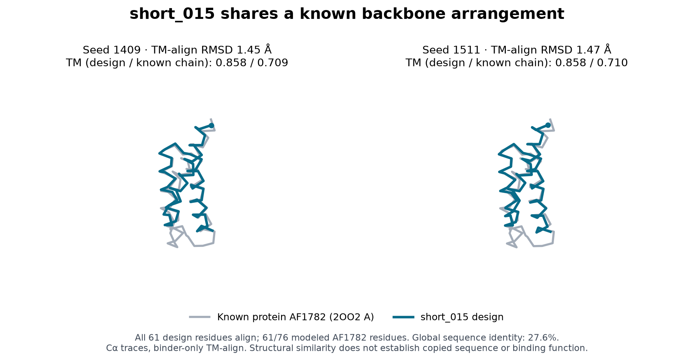

# Database similarity review

**The six sequences have no reported RCSB sequence hits under the recorded settings, but sequence distinctness does not imply a novel fold.** The clearest structural caveat is short_015: both poses closely resemble the known protein AF1782 (2OO2). Retain it as a known-backbone binding backup, without a fold-novelty claim. No sequence or submission rank was changed by this review.

Status: **COMPLETE_WITH_DATABASE_LIMITS**. Searches cover six distinct sequences from five parent lineages, both selected bare poses per design, and public retrieval controls. This review added **$0 Modal compute**.

## Sequence results

The RCSB sequence service returned HTTP 204/no hits for all six candidates at E-value ≤10 and identity cutoff 0. Both controls worked: the human TfR1 crop was recovered at 100% query identity/coverage, and the designed positive matched 6WRW entity 2 at 100% identity over all 88 residues. Controls validate retrieval in this panel; they do not quantify sensitivity for these short, compositionally biased designs.

Swiss-Prot BLASTp completed all seven queries, including retrieval of human TfR1 accession P02786 (pass). Across the six candidates, **0 alignments meet the predeclared close-sequence review rule** (identity ≥50%, query coverage ≥80%, E-value ≤0.001). Flags apply to individual HSPs, not unions of disjoint alignments. This is a review heuristic, not a competition cutoff. The composition-corrected, low-complexity-masked search is not proof that no related sequence exists.

The completed evidence comes from **local BLAST+ 2.17.0 against UniProtKB/Swiss-Prot canonical release 2026_03** (575,748 sequences; 209,017,843 residues). The original NCBI RID remained WAITING after more than an hour; it is still pending and is not described as completed. A [prospective fallback plan](local_swissprot/plan.json) preserved all seven queries and the screening thresholds before the local search. Official archive checksums were verified; commands, SHA-256 hashes, release metadata, logs and raw JSON results are archived in [local_swissprot/](local_swissprot/). The separate isoform supplement is excluded. This local database need not match the remote service's Swiss-Prot snapshot.

| Query | Reported HSPs | Smallest E-value | Close-sequence flags | Reported masked query intervals |
|---|---:|---:|---:|---|
| apical_short_008_A41H | 15 | 1.54 | 0 | `[{"from":15,"to":30}]` |
| expansion_apical_long_092 | 6 | 0.672 | 0 | `[{"from":12,"to":28},{"from":59,"to":75}]` |
| expansion_apical_short_026 | 11 | 3.63 | 0 | `[{"from":46,"to":61}]` |
| expansion_apical_short_015 | 7 | 1.09 | 0 | `[{"from":1,"to":19},{"from":42,"to":57}]` |
| expansion_apical_short_018 | 8 | 0.26 | 0 | `[{"from":47,"to":60}]` |
| apical_short_008 | 5 | 0.656 | 0 | `[{"from":15,"to":30}]` |

The exact requests, retrieval timestamps and server responses are archived under [rcsb/](rcsb/) and [blast/](blast/); any completed local fallback is identified above. Current RCSB searches exclude computed models. Swiss-Prot is a curated sequence collection, not all known sequences or unpublished designs. Alignment identity, coverage and significance must be read together; short local similarities alone do not establish copied sequence. Low-complexity masking reduces sensitivity for these compositionally biased designs; a successful receptor control does not establish sensitivity for every candidate.

## Structural results

Foldseek completed all 13 binder-only queries against PDB100 and AlphaFold/Swiss-Prot. The known 2DS25.5 control retrieves 6WRW, with local TM-align scores approximately 0.993 under both length normalizations and full coverage. The input contains no receptor atoms or assay suffix, so receptor matches cannot dominate the search. Failed selected candidate poses remain included.

The table shows the **largest query-normalized TM score among the first ten server-ranked hits**, across the two poses. It is not the best score over the entire database, a novelty probability, or a binding metric.

| Design | RCSB sequence hits | PDB best query TM | AlphaFold/Swiss-Prot best query TM |
|---|---:|---:|---:|
| apical_short_008_A41H | 0 | 0.428 | 0.471 |
| expansion_apical_long_092 | 0 | 0.597 | 0.663 |
| expansion_apical_short_026 | 0 | 0.694 | 0.683 |
| expansion_apical_short_015 | 0 | 0.858 | 0.821 |
| expansion_apical_short_018 | 0 | 0.463 | 0.420 |
| apical_short_008 | 0 | 0.566 | 0.540 |

### short_015: a real known-backbone similarity

Independent comparison to the original [2OO2 coordinates](https://www.rcsb.org/structure/2OO2), author chain A, reproduces the match in both poses. All **61/61 design residues** align to **61/76 modeled AF1782 residues**. Query-normalized TM scores are **0.858/0.858**; target-normalized scores are **0.709/0.710**; TM-align-reported backbone RMSDs are **1.450/1.467 Å**. Global sequence identity is **27.6%**, using the longer modeled sequence as denominator.

This supports a shared backbone arrangement, not sequence copying, evolutionary homology, the same interface, or TfR1 binding by AF1782. Foldseek's corresponding E-values are weak (1.437/2.454), illustrating why a simple short helical fold can have close geometry without strong homology evidence. The design was generated de novo in this campaign; de novo generation does not require an unprecedented fold. Competition eligibility remains the organizers' decision.

### Other lineages and partial matches

- **long_092** has moderate similarity to known alpha/beta structures. Against [CcmK2, 3SSQ chain A](https://www.rcsb.org/structure/3SSQ), original-coordinate TM scores are 0.597/0.587 normalized by the design and 0.546/0.538 normalized by the modeled known chain. About 86.5% of the design and 76.2% of the known chain align. This is not evidence of an unprecedented topology.
- **short_026** matches part of [metacaspase 9, 8A53 chain C](https://www.rcsb.org/structure/8A53): query TM about 0.694, but target TM only 0.175–0.177. It covers 96.8–98.4% of the short design and only 19.7–20.0% of the 305-residue modeled chain. A region match is not a whole-protein duplicate.
- **A41H** has no Foldseek hits in one pose and only weak partial hits in the other; the strongest followed-up PDB query TM is 0.428. **short_018** also has relatively weak followed-up matches. Absence or weakness of retrieved hits does not establish a novel fold, especially with short models and finite search sensitivity.
- **A41H and its parent** remain one lineage. Across the four cross-pose comparisons, their reciprocal TM scores are approximately 0.947–0.971. The five parent lineages are distinguishable in the internal structural comparisons, but this is not a validated count of fold classes.

## Scope, reproducibility and limits

The [frozen plan](plan.json) precedes search results. [summary.json](summary.json) gives compact per-design results, [analysis.json](analysis.json) retains all returned-hit metrics and local top-ten alignments, and [original-PDB verification](independent_pdb_verification.json) documents the named-chain checks. Full Foldseek responses are losslessly compressed alongside tickets and statuses; follow-up coordinate/sequence arrays are archived. Both length normalizations and alignment coverage are retained. All structures are compared in a binder-only fitted frame, separate from the receptor-fitted interface RMSD used earlier. The plotted transformation is checked against TM-align's distance markers.

The live server advertises **PDB100 20240101** and **AlphaFold/Swiss-Prot v6**; the full database parameters are in [database_inventory.json](database_inventory.json). The old PDB structural snapshot limits recent-structure coverage, even though the separate RCSB sequence search is current. Long_092 approaches the server's hit-count limit in AlphaFold/Swiss-Prot. Only the first ten hits per query/database receive local TM-align, and no exhaustive all-PDB or all-UniProt structural alignment was attempted. AlphaFold matches are predicted structures. No universal novelty verdict follows from these results.

Queries use the exact sequences and binder coordinates already available in the public project repository; [the provenance check](public_provenance_check.json) records source URLs and hashes. No new sequence designs, emails, upstream issues/PRs or challenge submission were created by this review.

## Recommendation

Keep **A41H as the leading pH-direction hypothesis**, and keep **long_092 and short_026** as binding candidates. Keep short_015 as a transparently labeled known-backbone backup; do not spend compute merely to make a fold look novel. The larger unresolved problems remain actual human binding, assay-tag compatibility, pH release and mouse cross-reactivity.

If expanding the shortlist, use one bounded apical generation batch to seek additional structurally distinct, well-supported parents, and apply this same sequence/structure audit before adding them. Avoid filling twenty slots with near-identical His variants. The current draft remains a computational submission, not a validated binder panel.

Reproduce interpretation locally with `scripts/analyze_novelty.py`, `scripts/verify_novelty_matches.py`, `scripts/plot_novelty_review.py`, then `scripts/summarize_novelty.py`. Network acquisition commands are in `scripts/novelty_search.py`; submission commands reuse archived tickets and do not silently resubmit jobs. The local Swiss-Prot fallback uses `scripts/local_swissprot.py` and the official URLs/checksums in its frozen plan; large downloaded archives and executables stay in ignored `outputs/`.

Method references: [RCSB search API](https://search.rcsb.org/), [Foldseek](https://github.com/steineggerlab/foldseek), [NCBI BLAST URL API](https://blast.ncbi.nlm.nih.gov/doc/blast-help/urlapi.html), [TM-align bindings](https://github.com/jvkersch/tmtools). These sources describe the methods; the candidate conclusions above come from this repository's archived calculations.
