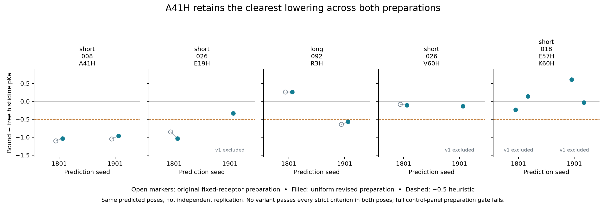

# Uniform receptor preparation and assay-tag review

**A41H remains the best pH-direction hypothesis. The preparation resolves all four previously excluded calculations, but does not produce a strict two-pose hit.** E19H now has a usable second pose; its smaller effect weakens the case for advancing it ahead of A41H. This is a sensitivity analysis on existing predictions, not new independent structural evidence or experimental validation.

## What was done

The procedure was specified before revised outcomes and applied once to all 28 selected models from the latest confirmation: candidates, parents, a published positive and two presumed negatives. Original raw and fixed-receptor results remain unchanged. Both backbones are restrained with the same 1000 kJ/mol/nm² coefficient; receptor side chains and hydrogens can now move. Amber14/GBn2 minimization has 500-iteration, 120-second minimization and 180-second total limits. No model receives a selective repair, retry or alternative rotamer.

The original-frame movement limits are RMS ≤0.5 Å and maximum atom movement ≤1 Å for each backbone. A new diagnostic rejects any intrachain nonbonded heavy-atom pair below 1.8 Å, excluding covalent bonds. Original pose, hotspot, contact and full-context checks remain in force. The new receptor movement rule is explicitly a different preparation diagnostic; it does not replace v1's fixed-receptor criterion. All free/bound pKa calculations use the same prepared binder conformation, stripped of explicit hydrogens before PROPKA.

## Preparation result

| Check | Result |
|---|---:|
| Preparation completed | 28/28 |
| Backbone movement guards | 25/28 |
| Severe intrachain nonbonded overlaps | 14 atom pairs before; 0 after |
| Free/bound PROPKA calculations with no warnings | 56/56 |
| Eligible after raw decisions and all revised diagnostics | 22/28 |
| Positive-control prepared checks | 2/2 |
| Complete prepared control-panel checks | 4/6; failed |

The published positive retains 94.6% and 96.4% native-contact recall, with receptor-fitted interface Cα RMSDs of 1.01 and 1.25 Å. Both scrambled-control poses exceed the backbone maximum-displacement guard (1.291 and 1.077 Å). The A41H parent at seed 1801 also exceeds it (1.022 Å). These exclusions remain. Three original raw-screen failures also remain excluded even where their local geometry improves. All ten previously admitted mutant poses pass the revised model-level diagnostics, but the full control-panel preparation gate is not validated.

Final RMS force-component values are 4.70–5.78 kJ/mol/nm. Removal of severe overlaps and protonation warnings does not prove complete stereochemical correctness, convergence to a unique state or biological accuracy.

## Direction results

Shifts are bound minus free pKa; negative is the intended direction. Ratios are introduced-histidine-only independent-site Kd(6.0)/Kd(7.4) proxies, not measured affinity ratios.

| Variant | Shifts, seed 1801 | Shifts, seed 1901 | Ratio proxies, 1801 / 1901 | Interpretation |
|---|---:|---:|---:|---|
| short_008 A41H | −1.036 | −0.963 | 4.45 / 2.48 | Strongest consistent direction; free pKa 7.235 in one pose fails the unchanged 6–7 heuristic |
| short_026 E19H | −1.036 | −0.335 | 4.45 / 1.56 | Secondary; newly usable second pose misses shift and ratio thresholds |
| long_092 R3H | +0.261 | −0.568 | 0.72 / 1.92 | Inconsistent direction |
| short_026 V60H | −0.106 | −0.132 | 1.18 / 1.19 | Effects too small |
| short_018 E57H/K60H | −0.236 / +0.139 | +0.607 / −0.031 | 1.10 / 0.42 | No consistent pair mechanism |

Only A41H seed 1901 meets every model-level direction heuristic. No variant meets them in both poses, independently of the incomplete prepared control-panel validation. A41H's original four-pose evidence is not increased to six independent poses by re-preparing two existing structures. Its matched parent also has the movement failure described above, so these results do not establish improved affinity over the parent.



For the double mutant, left/right markers within each seed represent H57/H60.

## Assay construct found

[Adaptyv's construct documentation](https://docs.adaptyvbio.com/wiki/technologies/construct-tag-design) specifies a default 64-residue C-terminal suffix comprising flexible linkers, split-GFP11 and Twin-Strep. It contains four histidines. The platform says the tag is retained and bare binder sequences should be supplied. The [TfR1 challenge page](https://proteinbase.com/competitions/anthropic-adaptyv-2026/challenges/tfr1) confirms C-terminal Twin-Strep capture, but does not independently list the entire suffix. Therefore the exact public platform default is available; its challenge-specific applicability is an explicit assumption for modeling.

The exact suffix, provenance, and 14 tagged modeling sequences are in [the construct manifest](../../data/assay_tag_review/manifest.json) and [modeling FASTA](../../data/assay_tag_review/tagged_for_modeling_only.fasta). These are not submission sequences. No tag prediction has been run and no tag-compatibility claim is made.

In the two prepared A41H models, the binder's terminal carboxyl is 17.9–18.1 Å from the target, and H41 is 16.9–17.7 Å from that carboxyl. For E19H, corresponding distances are 7.3–7.4 Å and 24.9–25.0 Å. These observations favor inspecting A41H first, but flexible tag placement cannot be inferred from these distances. V60H and the H57/H60 pair lie closer to the binder terminus and have weaker direction evidence. Appending a tag also changes terminal chemistry; the current untagged pKas cannot establish tagged behavior.

## Recommendation

Advance **A41H plus its unmodified parent** to a bounded, matched bare-versus-platform-default-tagged prediction panel. Include **E19H and its parent as a secondary pair**, plus the published positive, scrambled control and unrelated VHH. Two fresh seeds, five samples, seven cases and two construct conditions give 140 predictions. This is the proposed next experiment, not a launched run.

Evaluate the designed binder core separately from the appended suffix: core pose, target contacts, confidence/PAE restricted to the core, full-dimer clearance, and tag-to-receptor contacts. Do not reuse a whole-chain confidence threshold blindly after doubling a short binder's length, and do not count tag contacts toward the intended interface. Preserve the matched controls and report any calibration failure. Only retained core poses should enter subsequent tagged pKa sensitivity analysis; the extra tag histidines must not be presented as a designed release mechanism. The exact tag and its conformational uncertainty matter more now than generating another large batch or tuning preparation until everything passes.

Pause R3H, V60H and the double mutant. Keep E19H as a secondary hypothesis. Mouse cross-reactivity remains unknown. No submission, upstream issue, PR or external message was sent.

## Reproduction and verification

```bash
OPENMM_CPU_THREADS=2 .venv/bin/python scripts/receptor_preparation_v2.py
.venv/bin/python scripts/analyze_receptor_preparation_v2.py
.venv/bin/python scripts/prepare_assay_tag_review.py
.venv/bin/python scripts/plot_receptor_preparation_v2.py
.venv/bin/python scripts/audit_receptor_preparation_v2.py
.venv/bin/python -m pytest -q
```

Creation scripts refuse to overwrite an existing preparation/construct directory. The tag script reads the public source saved at `outputs/adaptyv-construct-tag-design.md`; its digest is in the manifest. [Frozen protocol and source hashes](plan.json), [per-model analysis](analysis.json), and [evidence audit](evidence_audit.json) preserve the full trail. Sixty tests pass. All work in this round was local CPU work, adding **$0 Modal compute**. Latest previously recorded gross Modal spend remains approximately **$10.45 of $30**; no new cloud jobs were launched.
