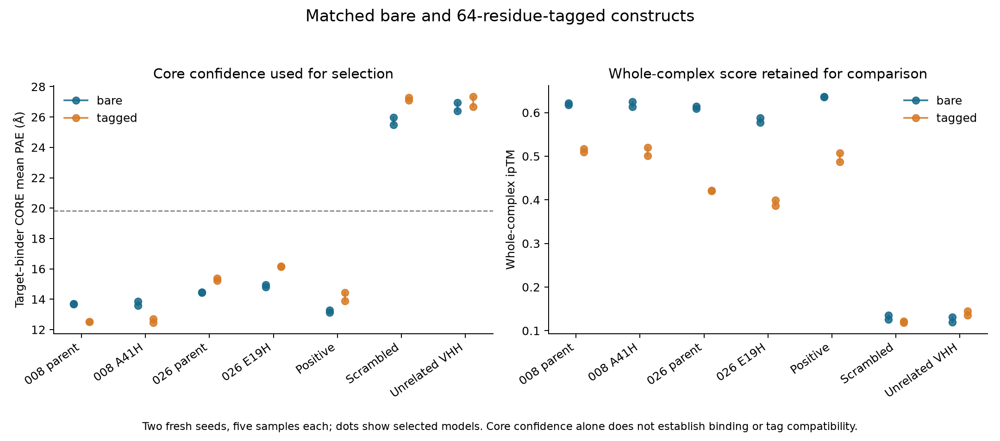

# Matched bare versus tagged comparison

**A41H remains the leading hypothesis, but this round does not establish tag-compatible pH switching.** Both bare variants pass the fresh two-seed core screen. Neither tagged variant passes it in both selected poses, and none of the four tagged candidates/parents clears the conservative tag-independence rule. Low-confidence tag contacts also appear extensively on presumed negatives, so this is not proof that the tag prevents binding.

## Experiment and controls

The completed run `tag-comparison-022-6wrw` contains **140 predictions**: seven sequences, bare and tagged, two fresh seeds (2003, 2011), five samples each. The 64-residue suffix is Adaptyv's exact [published platform default](https://docs.adaptyvbio.com/wiki/technologies/construct-tag-design), including linkers, split-GFP11 and Twin-Strep; use of the complete default in this challenge is an explicit assumption. All 28 input preflights verify target-only templates, exclusion of the entire binder/suffix from templates, and single-sequence MSA depth. All predictions completed, and all cloud apps stopped.

The entire designed core is scored separately from the suffix. Among models with target Cα RMSD ≤2 Å, selection minimizes symmetric mean target/core PAE, with sample index breaking ties. The frozen core-confidence cutoff is **19.827851 Å**, the midpoint between the prior selected positive maximum and presumed-negative minimum. Core contact PAE must also be ≤10 Å. Whole-chain ipTM is reported but does not gate the tagged core. Original fold, pose, hotspot, contact and context-clash requirements remain. No desired geometry, tag clearance or pKa is used to select a sample.

All **12 selected raw control checks pass** across the two conditions. The selected positive has core PAE 13.14–14.45 Å, while presumed negatives have 25.48–27.34 Å. This supports confidence separation in this panel, not experimental specificity or affinity. Full-suffix docking itself is not calibrated by that result.



## Structural outcomes

| Core | Construct | Core passes among all samples | Both selected core screens | Both selected tag-independence screens |
|---|---|---:|---|---|
| short_008 | bare | 6/10 | Fail | Not applicable |
| short_008 | tagged | 6/10 | Pass | Fail |
| short_008_A41H | bare | 8/10 | Pass | Not applicable |
| short_008_A41H | tagged | 7/10 | Fail | Fail |
| short_026 | bare | 9/10 | Pass | Not applicable |
| short_026 | tagged | 8/10 | Pass | Fail |
| short_026_E19H | bare | 6/10 | Pass | Not applicable |
| short_026_E19H | tagged | 2/10 | Fail | Fail |

Tag independence requires zero suffix/target residue contacts within 5 Å and zero suffix clashes below 2 Å in the full receptor context. This was specified before prediction, is deliberately conservative, and is not a validated experimental classifier for flexible tags. No substitute sample is chosen when a selected pose fails.

Tagged A41H seed 2003 has one core close pair: **binder Glu5 OE1–target Thr376 OG1, 1.909 Å**. Its other selected tagged core passes. Tagged E19H misses the interface-pose rule in both seeds: receptor-fitted interface Cα RMSDs **2.185 and 2.403 Å**, versus 0.980 and 1.188 Å for the matched bare models. The bare A41H parent fails one raw clash check; therefore this panel also does not establish an affinity improvement over that parent.

Candidate tags have mean pLDDT approximately **0.33–0.36** and tag-contact PAE **23.54–27.58 Å**. Presumed negatives also accumulate many tag contacts. Their uncertain placement should not be interpreted as a real designed interface, and tag contacts never count toward core binding. A41H shows 109 versus 10 suffix/target contact pairs in its two selected poses, further illustrating this uncertainty. See the [descriptive contact audit](tag_contact_audit.json). The positive control has one tag contact in one seed and none in the other; zero-contact screening is not established as a universal compatibility criterion.

## Uniform preparation and direction analysis

All **28 selected models** receive one bounded v2 preparation, irrespective of raw outcome. The suffix stays attached throughout minimization and full free/bound PROPKA. Restraints apply to both backbones including the suffix; displacement admission guards apply to target and binder core, while full-tag movement is also reported. This avoids turning a flexible suffix displacement into a core failure. Raw failures are never rescued by minimization.

Metadata clarification: the inherited v2 description in the frozen plan retains its earlier cohort label and “No assay tag modeled” limitation; the latter also persists in the copied preparation metadata. Those text fields are stale for this run. The actual cohort, full sequences, suffix coordinates and core-movement scope are verified by the input and preparation audits. Historical records are preserved; [the clarification](metadata_clarifications.json) does not change coordinates, settings or decisions.

Core movement guards pass **23/28**; **56/56** free/bound PROPKA calculations complete without incomplete/protonation-failed groups. Prepared control-panel diagnostics: bare **Pass**, tagged **Fail**. These diagnostics are separate from the successful raw confidence controls above.

Preparation exclusions:

- `expansion_apical_short_026_E19H_bare`, seed 2003: core backbone guard fails; internal-overlap guard passes.
- `expansion_apical_short_026_tagged`, seed 2003: core backbone guard fails; internal-overlap guard passes.
- `scrambled_6wrw_tagged`, seed 2003: core backbone guard fails; internal-overlap guard passes.
- `apical_short_008_A41H_bare`, seed 2011: core backbone guard fails; internal-overlap guard passes.
- `scrambled_6wrw_tagged`, seed 2011: core backbone guard fails; internal-overlap guard passes.

Only variants passing both raw core screens and their raw controls can enter direction interpretation. They must also pass their own prepared core, internal-geometry and protonation checks. Tagged variants fail the raw two-seed requirement and remain excluded even though their full-construct raw pKa tables are retained. No core-only artificially terminated tagged pKas are used.

| Variant | Construct | Seed | Free pKa | Bound pKa | Shift | His-only ratio | Model-level direction result |
|---|---|---:|---:|---:|---:|---:|---|
| short_008_A41H | bare | 2003 | 6.481 | 5.872 | -0.608 | 2.12 | Pass |
| short_008_A41H | bare | 2011 | — | — | — | — | Prepared core movement/internal geometry failed |
| short_008_A41H | tagged | 2003 | — | — | — | — | Raw core screen or controls fail in a selected seed |
| short_008_A41H | tagged | 2011 | — | — | — | — | Raw core screen or controls fail in a selected seed |
| short_026_E19H | bare | 2003 | — | — | — | — | Prepared core movement/internal geometry failed |
| short_026_E19H | bare | 2011 | 7.435 | 6.768 | -0.667 | 2.43 | Fail |
| short_026_E19H | tagged | 2003 | — | — | — | — | Raw core screen or controls fail in a selected seed |
| short_026_E19H | tagged | 2011 | — | — | — | — | Raw core screen or controls fail in a selected seed |

The ratio is an introduced-histidine-only independent-site Kd(6.0)/Kd(7.4) proxy. It is not an affinity measurement and does not count the tag's four histidines as a designed mechanism. Strict requirements remain shift ≤−0.5, a free pKa within 6–7, ratio ≥2 and distance ≥10 Å from artificial target termini. There are **0 fully qualified two-pose direction passes**. No human binding, acidic release, mouse cross-reactivity or capture-surface compatibility has been experimentally demonstrated.

## Recommended next step

Keep **A41H as the primary submission hypothesis**, paired with its unmodified parent as a mechanistic comparator. Deprioritize E19H relative to A41H; retain its family only for diversity and clearly label the uncertainty. Do not repeat seeds or tune thresholds merely to obtain a passing tagged model, and do not discard A41H solely because an uncertain flexible suffix docks onto the target.

Move next to a **ranked submission draft and sequence/developability/diversity audit** of the existing strongest families. Preserve the strict exclusions and distinguish promising long shots from qualified computational results. Use any further generation allocation to add genuinely different apical scaffolds rather than more close A41H variants. Tag compatibility stays an unresolved limitation in the method; the current data do not justify claiming that a tagged switch is validated. This report is not a challenge submission, and the generated tagged strings are modeling inputs only.

## Evidence, cost and reproduction

- [Frozen plan](plan.json), [all-sample results](results.json), [140-prediction audit](prediction_audit.json).
- [Selected raw structures and full PAE/pLDDT arrays](review_bundle/manifest.json).
- [Prepared core audit](prepared_core_audit.json), [direction decisions](direction.json), [final evidence audit](round_evidence_audit.json).
- Sixty-four tests pass. Gross Modal usage is **$10.75 of $30**, up approximately **$0.30** for this run, subject to meter lag. The run reserved at most $2. No new generation, upstream issue, PR, external message or submission was made.

```bash
.venv/bin/python scripts/download_pilot.py tag-comparison-022-6wrw outputs/tag_comparison022_complete
.venv/bin/python scripts/analyze_tag_comparison.py outputs/tag_comparison022_complete/tag-comparison-022-6wrw
.venv/bin/python scripts/audit_tag_comparison.py outputs/tag_comparison022_complete/tag-comparison-022-6wrw
.venv/bin/python scripts/plot_tag_comparison.py
.venv/bin/python scripts/audit_tag_contacts.py
OPENMM_CPU_THREADS=2 .venv/bin/python scripts/prepare_tag_models.py
.venv/bin/python scripts/audit_tag_preparation.py
.venv/bin/python scripts/check_tag_direction.py
.venv/bin/python scripts/summarize_tag_comparison.py
.venv/bin/python scripts/audit_tag_round.py
```

Creation and packaging scripts refuse to overwrite their existing output directories. Raw cloud predictions remain in the existing Modal results volume and the local ignored output archive. Controls are calibration constructs, not submission candidates.
